# Camera, inference, and display pipelines

See [the 2026-10-18 performance audit](PERFORMANCE.md) for benchmark interpretation,
verified SIMD / build settings, cache and model placement, and where camera
frame dropping occurs relative to DMA.
See [the repeatability investigation](INFERENCE_DIAGNOSTICS.md) for the
preemption-sensitive raw-output failure and scheduling correction.

This describes the current application and `build/tab5/sdkconfig`. Resolutions
are **width x height**. Blue nodes run on dedicated hardware, orange nodes run
on the CPUs, green nodes hold data, and grey orphaned nodes are unused by this
application. Arrows show image or result flow, not physical wiring.

```mermaid
flowchart TD
    sensor["SC202CS camera sensor<br/>Hardware: sensor<br/>1280 x 720 RAW8 Bayer, 16:9<br/>Custom sensor rate: 5 fps; VTS 7500"]
    csi["MIPI-CSI receiver<br/>Hardware: ESP32-P4 CSI, 1 data lane<br/>1280 x 720 RAW8"]
    isp["Image signal processing<br/>Hardware: P4 ISP; CPU IPA control task<br/>Demosaic, exposure / white balance control<br/>Output: 1280 x 720 RGB565"]
    capture["Capture buffers in PSRAM<br/>3 V4L2 MMAP buffers<br/>Each: 1280 x 720 RGB565<br/>Stride: 2560 bytes"]
    select["Capture / preview task<br/>CPU 0: acquire buffer and select preview frames<br/>V4L2 delivery: 5 fps; no frame skipping"]
    ppa["Shared crop, scale and rotate<br/>Hardware: PPA SRM + DMA2D<br/>Centre crop (320,40), 640 x 640; scale 0.5<br/>Rotate 90 degrees clockwise; output 320 x 320 RGB565"]
    preview["Two aligned PPA output buffers in PSRAM<br/>Each: 320 x 320 RGB565; 204800 bytes<br/>Detector idle: write directly into inference buffer<br/>Detector busy: write into preview staging buffer"]

    sensor --> csi --> isp --> capture --> select --> ppa --> preview

    subgraph detection["Inference path"]
        snapshot["Private inference buffer: held until detector finishes<br/>320 x 320 RGB565; stride 640 bytes<br/>Same PPA output is displayed for this frame<br/>No second PPA pass or CPU inference snapshot copy"]
        preprocess["ESP-DL preprocessing<br/>CPU 1: RGB565 to RGB888, normalization / quantization<br/>320 x 320 to 320 x 320: no spatial resize or padding"]
        tensor["Model input tensor<br/>320 x 320 x 3 RGB, signed INT8<br/>All pixels contain image content"]
        model["YOLO11 nano, 320-input COCO model<br/>CPU 1, task priority 1: optimized SIMD kernels, single-core<br/>80 classes; weights embedded in flash<br/>Model working memory in RAM / PSRAM"]
        post["ESP-DL postprocessing<br/>CPU 1: box decoding, score filtering, NMS<br/>Score threshold 0.25; NMS threshold 0.5<br/>Boxes already use preview coordinates, 0 to 319"]
        results["Latest results queue: 1 entry<br/>Up to 10 boxes, class IDs and confidence scores<br/>Also sequence number, source timestamp and inference time"]
        snapshot --> preprocess --> tensor --> model --> post --> results
    end

    preview -->|"Detector idle: notify with private buffer; otherwise skip inference"| snapshot

    subgraph display["Screen path"]
        canvas["CPU 0: memcpy under LVGL lock<br/>Persistent canvas buffer in PSRAM<br/>320 x 320 RGB565; centred without upscaling"]
        overlays["CPU 0: update LVGL objects<br/>Entire preview is the detection area<br/>Live and previous still both retain latest boxes<br/>Five-square timing guide uses last inference duration"]
        render["LVGL task: CPU 0 software rendering, priority 4<br/>Compose live view, two stills and text into 720 x 1280 UI<br/>2 draw buffers, each 720 x 50 RGB565, in internal RAM"]
        fb["Hardware: DMA2D copies rendered regions<br/>LCD framebuffer in PSRAM<br/>720 x 1280 RGB565; 1 framebuffer"]
        dsi["Hardware: continuous full-frame scanout + MIPI-DSI<br/>720 x 1280 RGB565<br/>60 MHz pixel clock; calculated 48.21 Hz"]
        panel["Tab5 LCD panel<br/>720 x 1280 portrait<br/>Detected board v1: ILI9881C"]
        canvas --> overlays --> render --> fb --> dsi --> panel
    end

    preview -->|"Every physical sensor frame: 5 fps"| canvas
    snapshot -->|"CPU 0: copy once per new inference, under LVGL lock"| analysing
    analysing["Analysing still canvas in PSRAM<br/>320 x 320 RGB565; fixed for this inference"]
    previous["Previous result canvas in PSRAM<br/>Copy analysing still on completion before replacing it<br/>320 x 320 RGB565; overlays from matching result"]
    analysing -->|"Copy on completion"| previous
    results -->|"Matching boxes and labels"| previous
    analysing --> render
    previous --> render
    results -->|"CPU 0 polls queue; keeps last completed result"| overlays

    subgraph unused["Relevant unused hardware / operations - deliberately orphaned"]
        jpeg["P4 hardware JPEG encoder / decoder<br/>Unused: pipeline keeps uncompressed RGB565"]
        h264["P4 hardware H.264 encoder<br/>Unused: no compressed video recording or streaming"]
        blend["PPA blend and fill operations<br/>Unused by this pipeline; PPA SRM is active above<br/>LVGL renders overlays on the CPU"]
        sd["SDMMC host and microSD slot<br/>Unused: no frame recording or model loading from SD"]
        isp_crop["ISP crop hardware<br/>Unavailable on this P4 revision 1.0<br/>Supported only on revision 3.0 and later"]
    end

    classDef hardware fill:#dbeafe,stroke:#2563eb,color:#111827;
    classDef cpu fill:#ffedd5,stroke:#ea580c,color:#111827;
    classDef memory fill:#dcfce7,stroke:#16a34a,color:#111827;
    classDef idle fill:#f3f4f6,stroke:#9ca3af,color:#4b5563,stroke-dasharray:5 5;
    class sensor,csi,isp,ppa,fb,dsi,panel hardware;
    class select,snapshot,preprocess,model,post,canvas,overlays,render cpu;
    class capture,preview,tensor,results,analysing,previous memory;
    class jpeg,h264,blend,sd,isp_crop idle;
```



- **Physical capture rate:** a custom SC202CS mode extends vertical blanking
  to VTS 7500 (from 1250), retaining the original PLL, MIPI bitrate, HTS and
  per-line exposure timing. Both sensor format metadata and V4L2 delivery are
  5 fps; the delivery skip factor is 1. The sensor registers are read back and
  serial cadence logs measure five frame intervals independently of inference.
  A 3-second dequeue timeout accommodates the slower physical stream.
- **Results can lag the preview:** the screen keeps showing the live preview
  while CPU 1 detects objects in its private PPA output. The last completed boxes
  remain visible until replaced, and the UI reports their source frame's age.
- **Detection field of view:** capture remains 1280 x 720. A centred 720-square
  crop, halved to 360 and then cropped to 320, is geometrically equivalent to
  the implemented centred 640-square crop halved directly to 320. It discards
  40 source pixels from each edge of that 720-square view. The screen now shows only this
  cropped field of view; it has the same spatial coordinates as the model input.
- **Hardware crop and stride:** PPA reads a rectangular block inside the full
  camera buffer using `pic_w = stride / 2` and block offsets. There is no CPU
  crop copy. A single pass also applies the 270-degree counter-clockwise rotation.
  PPA writes directly into the inference buffer when it is free. During
  inference, subsequent preview frames use the other output buffer. Only the
  per-frame live canvas copy remains, protected by the LVGL lock. Two
  additional still buffers are copied only on inference submission / completion.
- **ESP-DL stride limitation:** the installed `img_t` has no independent stride;
  `row_step()` equals width times pixel size. The lower-level preprocessor does
  accept a crop rectangle within an image whose width describes its full row.
  The model tensor itself must be contiguous. Our direct packed PPA output
  avoids requiring a strided model input or modifying the dependency.
- **Preprocessing:** ESP-DL still converts colour and normalizes / quantizes
  into the INT8 tensor. Supplying RGB565 at 320 x 320 removes spatial resizing
  and padding, but does not remove this necessary conversion or change weights.
- **ISP colour correction:** the custom SC202CS profile omits calibrated CCM
  tables. ACC remains registered for other settings. The physical CCM hardware
  can still apply white-balance gains, so it is not listed as unused hardware.
- **DMA2D has two roles:** it transfers PPA image data and copies LVGL output
  into the LCD framebuffer. It does not execute the neural network or render
  the bounding-box labels. There is no JPEG/H.264 encode/decode stage here.

Implementation references: [camera capture](main/camera.cpp),
[PPA transform, task handoff, detection and UI](main/main.cpp),
[default configuration](sdkconfig.default), and
[ISP profile notes](config/README.md). The display-buffer and DMA2D details also
depend on the current Tab5 BSP and generated `build/tab5/sdkconfig`.

## Profiling the inference branch

Every completed detection emits a `PROFILE` serial line, with milliseconds for:

| Field | Measurement |
| --- | --- |
| `preview` | Zero: the separate full-view PPA pass has been removed |
| `ppa` | Shared preview/inference crop / half-scale / rotate, including DMA wait |
| `wait` | Detector task scheduling delay after notification is prepared |
| `pre` | ESP-DL colour conversion, normalization and quantization |
| `model` | Neural network execution, single-core mode |
| `post` | Box decoding, filtering, NMS and ESP-DL result extraction |
| `total` | Camera dequeue completion to mapped results ready, before logging |

These are wall times under the live camera/display workload, including task
preemption, not isolated CPU execution times. `total` also includes camera
buffer release, result mapping and small gaps between stages. It excludes sensor
exposure/readout, time already spent queued in V4L2, and display presentation.
The first inference is marked `cold`; model loading is outside these timings.
Serial logging happens after stage measurements. Compare several dozen warm
samples with the same scene and workload before claiming a speed improvement.

Save the serial output to a file, then run:

```powershell
python tests/summarize_profile.py capture.log
```

The script excludes cold samples and prints mean, median, p95 and maximum for
each stage. No performance numbers are assumed from the build alone.

### Historical measurement before shared-preview change, 2026-10-16

The previous two-pass version was flashed and verified on the connected Tab5, ESP32-P4 revision 1.0, with the live
camera and screen active. Four warm samples after the first cold run gave:

| Stage | Mean elapsed time |
| --- | ---: |
| Preview PPA | 41.108 ms |
| Inference PPA crop / half-scale / rotation | 19.057 ms |
| Scheduling wait | 1.702 ms |
| Input conversion / normalization / quantization | 64.040 ms |
| Neural network | 8327.410 ms |
| Postprocessing | 21.239 ms |
| Total, dequeue to mapped results | 8474.697 ms |

The network accounts for about 98% of branch elapsed time. The direct crop
removes the CPU snapshot copy and spatial preprocessing, but these measurements
do not demonstrate an overall speedup: there is no controlled before/after run
of the same scene. This small sample establishes where to investigate next:
model execution, task scheduling and memory/cache behaviour. It is not a
representative accuracy or performance benchmark. All four samples returned
zero objects, so bounding-box alignment and detection accuracy still require
testing with recognizable objects in the cropped preview. No PPA errors, watchdog
resets or crashes appeared during the captured interval.

Raw output: `build/tab5/inference_profile.log` (local build artifact).

## ISP crop and recommended path for this board

The connected ESP32-P4 is revision 1.0. ISP hardware cropping is supported only
from revision 3.0; the installed ISP driver explicitly returns NOT_SUPPORTED on
older silicon. The esp_video V4L2 crop interface is also compiled out for this
build. See [Espressif ISP crop documentation](https://docs.espressif.com/projects/esp-idf/en/latest/esp32p4/api-reference/peripherals/isp.html).

For the present board and sensor mode, use CSI / ISP at 1280 x 720 RGB565,
then one PPA pass to crop 640-square, half-scale and rotate to 320-square.
Share that output between display and inference as described above. This
removes the separate 360 x 640 preview pass and reduces display copying to
204800 bytes per preview frame. The model still needs RGB conversion and INT8
normalization/quantization on the CPU. A suitable sensor crop/window mode could
reduce capture bandwidth further, but would require separate SC202CS mode and
ISP calibration validation; it is not configured here. Pipeline simplification
does not resolve the previously measured multi-second neural-network runtime.

### Shared-preview runtime check, 2026-10-16

The single-pass build was flashed and its contents verified on the same Tab5.
Three complete warm profile samples averaged 17.949 ms for the shared PPA pass,
45.337 ms for preprocessing, 6019.960 ms for the model and 12.710 ms for
postprocessing; dequeue-to-result time averaged 6097.739 ms. `preview=0` confirms
there is no additional full-view PPA pass. This short run completed without
captured PPA errors or watchdog resets. All samples returned zero objects, so
visual accuracy and box placement remain unverified. The lower elapsed times
than the earlier two-pass run are observations under the running workload,
not a controlled same-scene performance benchmark.

Raw output: `build/tab5/shared_preview_profile.log` (local build artifact).

## Live view, stills and sampling guide

The live 320-square view starts at (200,118). Below it, five 32-pixel squares
form a simple timing guide. The analysing and previous-result 320-square stills
are side by side at (24,638) and (376,638). All dimensions are screen pixels.

The analysing still changes only when a new image is submitted to inference.
When inference completes, that still is copied to the previous-result canvas
before the next sample replaces it, so the previous still and boxes stay paired.
The same completed boxes remain on the live view until the next result arrives.
A result with no detections clears boxes in both views.

No square is highlighted during the first inference. Afterwards, exactly one
square is highlighted, advancing at 0%, 25%, 50%, 75% and 100% of the previous
measured inference duration. A 100 ms LVGL timer updates the guide independently
of the 5 fps preview. The last square stays highlighted if the current run takes
longer; the next submitted sample resets it. It is an estimate, not measured
model-layer progress, and does not delay inference or capture.

The stills / 5 fps build was compiled, flashed and verified on the Tab5. Six
complete warm profiles in `build/tab5/stills_runtime.log` averaged 5042.923 ms
dequeue-to-result, with no captured watchdog resets or crashes. One completed
inference returned an object, exercising the overlay update path. These are
short runtime checks, not visual validation of the panel or an accuracy test.

## Physical 1 fps sensor mode

This records the earlier 1 fps trial. The current sensor rate is 5 fps;
see [the physical 5 fps trial](#physical-5-fps-sensor-trial).

`Camera::configure_sensor_rate()` clones the pinned SC202CS 1280 x 720 RAW8
30 fps register table, appends VTS registers 0x320e/0x320f = 0x92/0x7c, and
publishes a persistent custom format with fps=1 and VTS=37500. HTS=1920 and
pclk=72 MHz remain unchanged; their product with VTS gives one frame/second.
The original per-line exposure conversion remains unchanged. The existing IPA
controller retains its conservative exposure range established at initialization.

The driver is instructed to deliver every frame rather than skip frames. Thus
1280 x 720 RGB565 capture payload drops from approximately 55.3 MB/s at 30 fps
to 1.84 MB/s at 1 fps, subject to the measured physical cadence. The instantaneous
MIPI bitrate does not change. The sensor change alone does not affect LCD
scanout; the lower LCD clock trials below were reverted after instability. The
preceding 5 fps runtime results document the earlier post-DMA skipping mode.

On-device validation on 2026-10-18: the custom VTS value read back correctly,
V4L2 reported 1/1 fps with no skipping, and seven consecutive five-interval
windows reported 1.000 fps after the initial settling window. Seven complete
warm profiles averaged 3419.188 ms in the network and 3500.126 ms dequeue to
result, with no captured camera errors or watchdog resets. Objects were detected
in two completed runs. These observations do not replace visual accuracy testing.
Logs: `build/tab5/sensor_one_fps_runtime.log` (local build artifact).

## LCD scanout clock trials

The saved ILI9881C clock is **60 MHz**, restored after both lower-clock trials
failed visual validation on this panel. The existing porches and 720 x 1280
RGB565 resolution remain unchanged.

| Pixel clock | Calculated refresh | Framebuffer payload | Result |
| --- | ---: | ---: | --- |
| 60 MHz | 48.21 Hz | 88.9 MB/s | Restored; user confirmed normal image |
| 50 MHz | 40.17 Hz | 74.1 MB/s | User reported flickering / blanking / distortion |
| 40 MHz | 32.14 Hz | 59.2 MB/s | User reported flickering / blanking / distortion |

Serial startup and inference continued at the lower clocks, demonstrating that
successful driver initialization does not prove that the panel displays a
stable image. Those rates are not accepted performance configurations.

The display remains in continuous DSI video mode: every physical refresh scans
the entire framebuffer, including unchanged pixels. LVGL uses partial rendering
and copies only dirty regions into that framebuffer. Its 33 ms refresh period
is not the physical panel refresh rate. The camera and live image remain at
1 fps during these trials and the five-square guide used its 100 ms timer.

`main/display_clock.cpp` intercepts the public DPI panel creation call using a
linker wrapper, copies the BSP configuration and changes only the pixel clock.
It recognizes the pinned ILI9881C timing; other panel revisions retain their
native BSP configuration. Managed component files are not modified. The clock
is configurable under `menuconfig` -> `Tab5 application`; default is the native
60 MHz. Changing panel timing or blanking to obtain a lower stable refresh rate
would be a separate experiment; lowering the pixel clock alone was unsuccessful.

Trial logs: `build/tab5/lcd_40mhz_runtime.log` and
`build/tab5/lcd_50mhz_trial_runtime.log` (local build artifacts).

## Cache and DMA ownership

The cache trial increases shared L2 from 128 KiB / 64-byte lines to **256 KiB /
128-byte lines**, configured in `sdkconfig.default`. L1 line size remains 64
bytes. IDF also supports 512 KiB L2, but cache consumes internal SRAM: 256 KiB
uses 128 KiB more SRAM than the original setting; 512 KiB would use 384 KiB more.
The app logs free/largest internal heap after model loading to check headroom.
Larger lines bring in more adjacent bytes per cache miss; this is not a claim
that a separate hardware prefetch mode was enabled or that every access is faster.

PSRAM image buffers remain CPU-cacheable. Both PPA buffers and all three CPU
canvas buffers use `esp_cache_get_alignment()` and aligned allocations with
rounded sizes. At 128-byte alignment, a 320-pixel RGB565 row is 640 bytes (five
cache lines); the 204800-byte image and 2560-byte camera stride are also aligned.
The video driver allocates its own aligned CSI buffers; we do not replace them.

| Handoff | Cache maintenance in the installed IDF 6.1 / esp_video 2.0.1 drivers | Ownership |
| --- | --- | --- |
| CSI/ISP DMA -> capture buffer | CSI driver invalidates before receive and again at completion (`DIR_M2C`) | App uses only dequeued buffers; requeues after blocking PPA finishes |
| Capture buffer -> PPA | PPA SRM driver writes back source window (`DIR_C2M`) | Capture buffer remains held and CPU does not modify it |
| PPA -> preview/inference | SRM driver invalidates aligned output window before DMA (`DIR_M2C`) | CPU reads only after blocking completion; inference buffer cannot be reused until detector releases it |
| CPU -> three canvases | Ordinary cached CPU copies; no DMA reads these canvases directly | LVGL lock serializes copies and rendering |
| LVGL -> LCD framebuffer -> DSI DMA | DPI CPU-copy path writes back changed framebuffer rows; DMA2D hook delegates source/destination sync to async color-convert driver | Display stack owns draw/flush completion |

No application code disables caching to avoid DMA synchronization. DMA bypasses
the CPU cache, so it cannot gain CPU read-ahead benefits itself. Additional
application-level flushes would duplicate driver work; a cache-to-memory flush
after a DMA write could instead overwrite fresh DMA data if stale dirty lines
were present. Correct synchronization, aligned ownership and completion waits
are required, rather than indiscriminate flushing.

Sources: installed `esp_driver_cam/csi/src/esp_cam_ctlr_csi.c`,
`esp_driver_ppa/src/ppa_srm.c`, `esp_lcd/dsi/esp_lcd_panel_dpi.c`,
`esp_video/src/device/esp_video_csi_device.c`, and Espressif's
[memory synchronization guide](https://docs.espressif.com/projects/esp-idf/en/latest/esp32p4/api-reference/system/mm_sync.html)
and [cache performance guidance](https://docs.espressif.com/projects/esp-idf/en/latest/esp32p4/api-guides/performance/speed.html).

### Cache trial results, 2026-10-18

Built, flashed and hash-verified on the revision-1 Tab5. The 45-second serial
capture contains 18 complete warm profiles, with no captured errors, panics or
watchdog resets. Camera cadence stayed approximately 1.000 fps; LCD stayed at
the native 60 MHz clock.

| Configuration | Complete warm samples | Mean network | Mean dequeue-to-result |
| --- | ---: | ---: | ---: |
| Previous 128 KiB / 64-byte lines | 2 | 3437.137 ms | 3515.013 ms |
| 256 KiB / 128-byte lines, all app image buffers aligned | 18 | 1351.330 ms | 1428.497 ms |

This is approximately 2.54x faster network execution (60.7% less wall time).
It compares live-camera captures, not a frozen input; cache capacity, line size
and CPU-canvas alignment changed together, so the improvement cannot be
attributed separately to each. It does not establish detection accuracy.

After model loading: internal free **116231 bytes**, largest internal block
**51200 bytes**, PSRAM free **21320400 bytes**. A 512 KiB cache would consume
another 256 KiB of internal SRAM, so it was not selected for this workload.
The retained default is 256 KiB / 128-byte lines.

Logs: `build/tab5/lcd_native_runtime.log` (previous baseline),
`build/tab5/cache_256_build.log`, `build/tab5/cache_256_flash.log` and
`build/tab5/cache_256_runtime.log`. Summaries use `tests/summarize_profile.py`,
which excludes the first cold inference. Optimization and ISP profile checks
also passed.

## Inference correctness follow-up

The cache-trial timings above predate a discovered repeatability problem:
identical image and INT8 input checksums produced changing raw network outputs
with the original idle-priority detector scheduling. The problem reproduced
at both cache sizes and at ESP-DL `-O2`; suspending task switching removed it.

The current app runs the detector at priority 1 on CPU 1 and pins LVGL to CPU 0.
It passed 48 repeated-run integrity checks across 128 KiB and 256 KiB caches,
including agreement with the suspended-switch controls. Normal firmware keeps
256 KiB / 128-byte cache, `-O3`, LCD 60 MHz and watchdogs
enabled; diagnostic scheduler suspension is compiled out.

The 1 fps validation's 35 warm live profiles average **677.563 ms network**, approximately
**696 ms detector** and **719.517 ms dequeue-to-result**. Capture remains near
1 fps in that validation run, allowing detection on every incoming frame. The exact underlying
kernel/RTOS-state cause remains unconfirmed; this is a tested scheduling
mitigation. Full evidence, limitations and reproduction instructions are in
[INFERENCE_DIAGNOSTICS.md](INFERENCE_DIAGNOSTICS.md).

## Physical 5 fps sensor trial

The current target is actual sensor readout and preview at **5 fps**, set by
`Camera::kTargetFps`. The custom SC202CS format extends the native 30 fps
frame length six-fold: VTS 1250 -> 7500 (`0x320e/0x320f = 0x1d/0x4c`).
Sensor format metadata and V4L2 delivery both request 5 fps, with no driver
skipping. Resolution stays 1280 x 720, RGB565 capture stride 2560 bytes,
and the 640-square PPA crop still produces 320-square inference/preview images.

Capture payload is approximately **9.22 MB/s**, versus 1.84 MB/s in the previous
1 fps mode and 55.3 MB/s at native 30 fps. MIPI bitrate and per-line exposure
timing stay unchanged; only frame blanking changes. The 256 KiB / 128-byte
cache, aligned buffers, LVGL core 0, inference core 1 / priority 1, and native
60 MHz LCD timing are retained.

Five fps applies to capture and preview. Inference samples the latest available
frame whenever the detector is free, without accumulating a frame backlog.
Its throughput is limited by measured model latency, not set to five runs/sec.

The 5 fps diagnostic build passed all **24 repeatability/integrity checks**
under the increased camera workload. The deterministic pattern's raw output
CRC remained `33c860ab`, matching the corrected 1 fps build; input/output
stability, heap metadata and image guards all passed. This checks repeatability,
not detection accuracy against a labelled dataset.

Local artifacts: `build/tab5/sensor_five_fps_audit_build.log`,
`sensor_five_fps_audit_flash.log`, `sensor_five_fps_audit_runtime.log`,
`sensor_five_fps_build.log`, `sensor_five_fps_flash.log` and
`sensor_five_fps_runtime.log` in the same directory.

The normal 5 fps build was flashed and hash-verified with diagnostics disabled.
A 40-second serial capture completed 35 warm profiles without captured errors,
crashes or watchdog resets. Across 37 cadence windows, capture averaged
**5.003 fps** including initial settling. Warm means were **850.508 ms network**,
approximately **870 ms full detector**, and **896.142 ms dequeue-to-result**.
Samples were submitted about once per second while preview continued at 5 fps.
The corresponding 1 fps capture run averaged about 696 ms full detector time;
this trial provides smoother preview with a higher inference latency.
